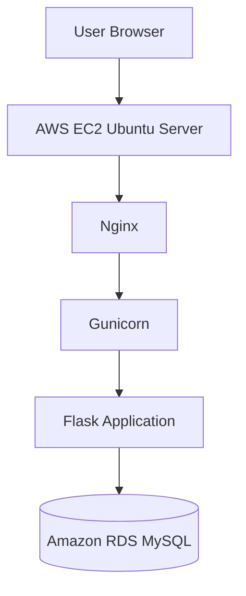

# AWS Student Management System

A cloud-hosted Student Management System built using Python Flask, MySQL, AWS EC2 and Amazon RDS.

## Project Overview

This project is a web-based application that allows administrators to manage student records through a modern and responsive dashboard.

The application is deployed on an AWS EC2 Ubuntu server and uses Amazon RDS MySQL for database management.

## Key Features

- Add new student records
- View all registered students
- Edit student information
- Delete student records
- Search and filter students
- Duplicate email validation
- Responsive admin dashboard
- Persistent MySQL database

## Technology Stack

| Category | Technology |
|---|---|
| Backend | Python, Flask |
| Frontend | HTML, CSS |
| Database | MySQL |
| Cloud | AWS EC2, Amazon RDS |
| Web Server | Nginx |
| Application Server | Gunicorn |
| Operating System | Ubuntu Linux |
| Version Control | Git, GitHub |
| Infrastructure | Terraform |

## AWS Architecture

The application is deployed on an AWS EC2 Ubuntu instance. Nginx receives HTTP requests and forwards them to Gunicorn, which runs the Flask application. The application connects to Amazon RDS MySQL for persistent data storage.



## Project Structure

```text
aws-student-management-system/
│
├── app.py
├── requirements.txt
├── .gitignore
├── README.md
│
├── templates/
│   ├── index.html
│   └── edit.html
│
└── static/
    └── style.css
```

## Terraform Configuration

Terraform infrastructure configuration is maintained separately from this application repository.

**Windows Location:**

`C:\student-management-system\terraform`

## Application Features

### Dashboard
Displays student records with search and management options.

### Add Student
Allows administrators to register students with name, email and course details.

### Edit Student
Allows updating existing student information.

### Delete Student
Allows removing student records.

### Database
Amazon RDS MySQL stores student information persistently.

## Deployment

The application is hosted on AWS EC2 Ubuntu with Nginx as a reverse proxy and Gunicorn as the WSGI application server.

AWS infrastructure was provisioned using Terraform. The Terraform configuration is maintained separately from this application repository.

## Learning Outcomes

- AWS EC2 deployment
- Amazon RDS MySQL integration
- Linux server administration
- Nginx configuration
- Gunicorn application deployment
- Flask application development
- Terraform infrastructure provisioning
- Git and GitHub version control

## Author

**Rohit Kharat**

GitHub: https://github.com/rohitKharat161

---

*This project was developed as a hands-on AWS Cloud and DevOps learning project.*